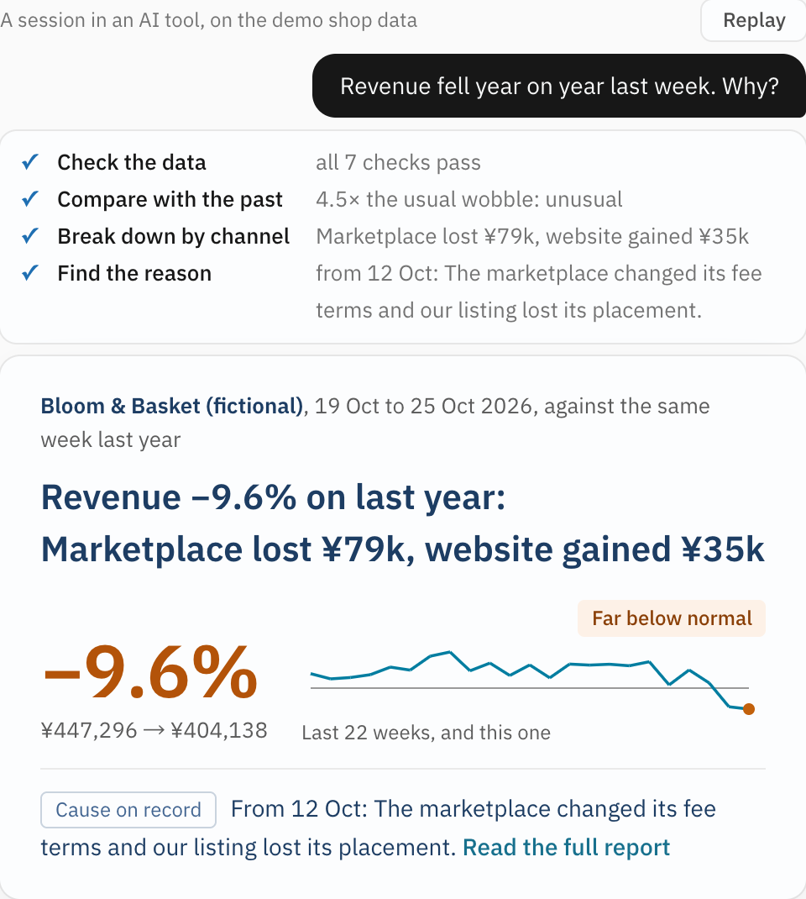
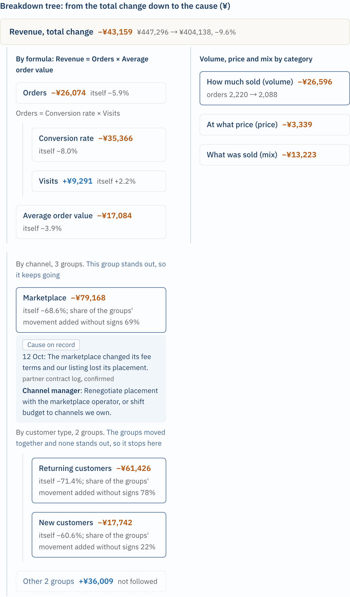
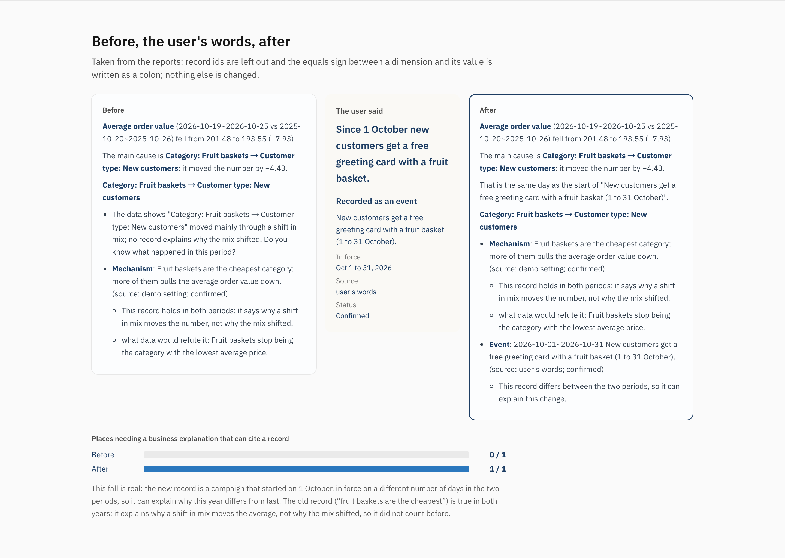
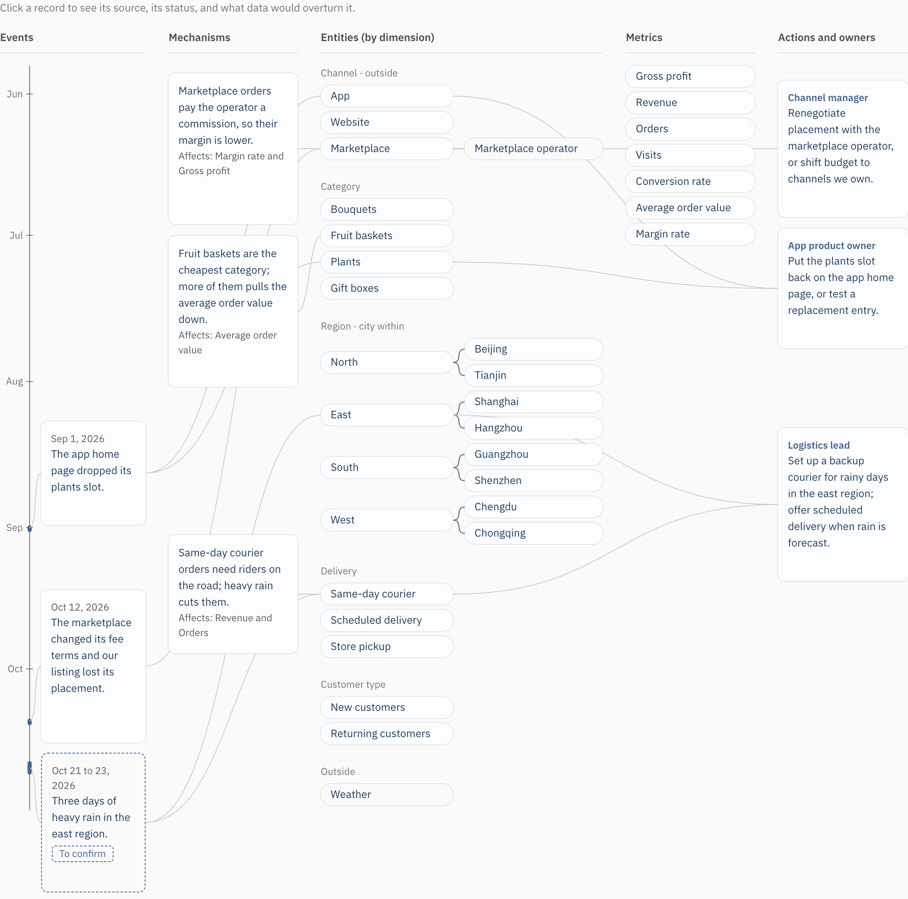

# analyst-in-a-box

[中文](README.zh.md)

[](LICENSE)
[](https://github.com/weigezi/analyst-in-a-box/actions/workflows/ci.yml)

**Ask why a number moved. Get the cause, who should act, and a breakdown that adds up to the total.**

<p align="center"></p>
<p align="center"><sub>Demo shop with generated data. <a href="docs/assets/demo.mp4">Watch the 76-second film</a> (on-screen text is in Chinese).</sub></p>

**12 published attribution methods &nbsp;·&nbsp; 12 checks before a report goes out &nbsp;·&nbsp; 30 of 30 planted causes found on shops it was never tuned on &nbsp;·&nbsp; 178 tests**

```bash
npx skills add weigezi/analyst-in-a-box
```

Then ask your AI tool:

> Here is our order table (path). Why did revenue fall last week?

It asks what each column means instead of guessing from names, then answers in the same conversation.

## Two breakdowns, one total

Revenue fell 43,159. The skill splits that two ways and both add up to it: by formula (conversion rate −35,366, order value −17,084, visits +9,291) and by channel (marketplace −79,168, website +34,816, app +1,193). It keeps cutting only where one group stands out, and stops where the groups moved together.

<p align="center"></p>

Scripts do all the arithmetic. They use methods published elsewhere (BEA contributions for sums, LMDI-I and Shapley for products, Kitagawa for ratios, among 12 in all), each with its citation in [`operators.md`](skills/analyst-in-a-box/references/operators.md). A report that fails any of its 12 pre-delivery checks is held back, with the failing check named.

## A cause is a record, not a restated result

"The marketplace fell" is where the money went. It does not say why. A cause has to be a dated record with a source, and the scripts test whether it can explain this change:

- it differs between the two periods;
- it starts on the day the change started;
- without it, the other channels look normal (+10.8% against a usual +7.7%).

In the demo, the record reads: from 12 October the marketplace changed its fee terms and our listing lost its placement (source: partner contract log, confirmed). That workspace was written by hand, so it also names an owner (the channel manager) and a next step. A workspace formed automatically from the tables and a weekly report reaches the same main cause, marks it "to confirm", and leaves the owner empty until you fill it in.

## It says when the data is wrong

Two missing days, or an order file loaded twice, and the report stops with the reason instead of a story. A quiet week is reported as quiet. This was tested on 15 trap cases: 12 with nothing planted (0 false alarms) and 3 with a real cause planted (0 misses).

Pure noise is not free: over 300 noise-only weeks it still drilled into a single point 15 times for revenue (5.0%) and 7 times for order value (2.3%).

## Tell it once, it remembers

Say "from 1 October, new customers get a greeting card with a fruit basket". It stores your sentence as a dated record with your words as the source, uses it the next time that question comes up, and writes a regression check. The share of the order-value change it could explain went from 0 to 100%. Delete the record and the check fails (1/1 becomes 0/1).

<p align="center"></p>

What it keeps is sorted by confidence. Facts are what you said, records from your systems, and what the data shows. AI inference is what was read from documents, general industry knowledge, and guesses, and it stays a draft until a person confirms it.

## Tangled tables become a business knowledge graph

Give it several exports and a weekly report. The scripts work out the main table, the lookups, how the tables join and which hold events; every guess comes back to you as a multiple-choice question. In the demo, nine tables (226,814 orders) became a workspace in about 3 seconds of script time once the shop owner's answers were in. It has two parts: a **metric tree** (what breaks down into what, and in which order each metric is cut) and a **business world description** (entities, mechanisms, dated events, actions and owners, each with a source and what would overturn it). Items still waiting for your confirmation are drawn dashed.

<p align="center"></p>

## Who does what

- **You** check that it understood your business (the tables, columns and joins it recognised, the causes it read from your documents) and correct a few spots.
- **The scripts** recognise tables, columns and joins, compute every number and run every check.
- **The AI** understands the question, writes the explanation in plain words and proposes candidate causes from your documents.

## Measured

All of this was measured on generated data or one public dataset, not on a real business.

| What | Result |
|---|---|
| Planted causes found, 6 generated shops never tuned on, 5 questions each | 30 of 30 |
| Trap cases (12 with nothing planted, 3 with a cause planted) | 0 false alarms, 0 misses |
| Every breakdown sums to the total change | 178 tests pass, and the same check runs before each report |
| Script time per question, Apple Silicon Mac | median 0.31 s (AI reading and writing time not included) |

## Try it

- Questions that work on the demo shop: why revenue fell; why the east region fell more than the rest; why order value dropped; whether June grew by selling more or charging more; why the app grew slower than the web.
- Several tables: give it a folder of exports, and a weekly report if you have one.
- From a terminal: `python3 skills/analyst-in-a-box/scripts/aib_cli.py init your_data.csv --workspace ./aib-workspace`
- Build the demo site from real runs: `uv run python site/build.py`. Run the tests: `uv run --frozen pytest`

## Documentation

- [Trial guide](docs/trial.en.md): trying it on your own business, and what to send back.
- [Decisions](docs/decisions.en.md): why it is built this way.
- [Several tables to a workspace](demo/intake/README.md) and [the public dataset](demo/public/README.md).
- [Contributing](CONTRIBUTING.md) and [security](SECURITY.md).

## Status

First public release. Tested on a generated demo shop, six more generated shops, the trap cases, and one public dataset (UCI Online Retail, CC BY 4.0). That dataset shows real data loads and yields a checked report; it has no answer key, so it does not show the answers are right. Nobody outside the project has tried it on their own business yet; the [trial guide](docs/trial.en.md) is how that changes. Not done yet: third-order questions, and news sources other than your own web search.

Found a bug, or tried it on your data? Open an issue. Licence: [Apache-2.0](LICENSE); the data in `demo/public` keeps its own licence.
