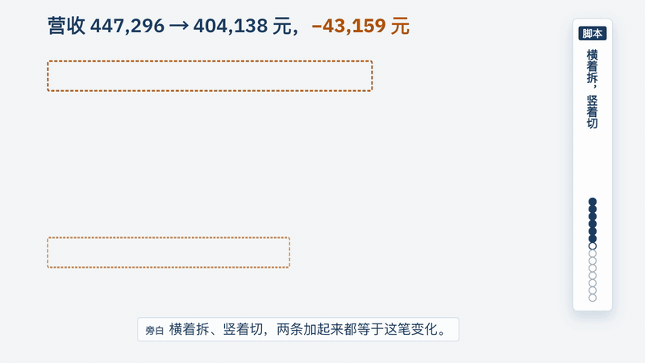

# analyst-in-a-box

[English](README.md)

[](LICENSE)
[](https://github.com/weigezi/analyst-in-a-box/actions/workflows/ci.yml)

**这个数为什么变了，接下来该谁去做什么？**

一个给 AI 工具用的 skill，像资深分析师那样解释一个变动的经营数字。拆解由脚本计算，各项相加等于总变化；
原因也不会是换了个说法的结果，而是一条带日期、带出处、必须通过核对的记录。

<p align="center">
  <a href="docs/assets/demo.mp4">
    
  </a>
</p>
<p align="center"><sub>演示店，数据由程序生成：上周营收与去年同期相比，拆成两种看法，两条相加都等于总变化。<a href="docs/assets/demo.mp4">看完整的 76 秒短片</a>。</sub></p>

```bash
npx skills add weigezi/analyst-in-a-box
```

## 谁做什么

全文用到三方。

- **你**看它对你业务的理解对不对（它认出的表、列和表之间的连接，从文档里读出的原因），不对就纠正几处。
- **脚本**认出表、列和连接，算每一个数，跑每一道核对。
- **AI**听懂问题，把解释写成大白话，从你的文档里提出候选原因。

理解对不对，你看一眼；分析，一键跑完。

## 拆得分毫不差的解释

在演示店里，上周营收同比少了 9.6%，是过去 22 个可比的周平时波动的 4.5 倍。确认异常之后，它才开始拆，拆两种：

- **按公式拆。** 转化率 −35,366，客单价 −17,084，访问量 +9,291。
- **按维度切。** 电商平台 −79,168，网页 +34,816，App +1,193。

两条相加都等于总变化 −43,159。脚本用的是公开发表的方法：加法用 BEA 的贡献度，乘法用 LMDI-I（有因子为零或负数时用
Shapley），比率用 Kitagawa。一共 12 种，每种的出处写在
[`operators.zh.md`](skills/analyst-in-a-box/references/operators.zh.md)。交付前的 12 项自检有一项不过，报告就不交。

**钱少在哪，和为什么少，是两层。** 拆解告诉你电商平台少了 79,168，但没有说为什么。原因必须是一条带日期、带出处的记录，
脚本再核对它能不能解释这一次的变化：两期里必须不一样，必须和变化从同一天开始，去掉它之后其余渠道要看起来正常
（其余渠道涨了 10.8%，平时约 7.7%）。演示里的记录是：10 月 12 日起，电商平台调整了费用条款，我们的商品失去了推荐位
（出处：合作方合同记录，已确认）。在这份手写工作区里，记录还写明了负责人（渠道负责人）和动作。

数据本身有疑问，它先说数据存疑。少了两天，或订单导重了，报告会写明原因并停发，不给出原因。

## 乱的表，自己长成业务知识图谱

给它几张原始导出表和一份文档。脚本认出哪张是主表、哪些是查找表、表之间怎么连（每个连接带覆盖率）、哪些是事件表，
每一个判断都以选择题的形式交回给你。它建出来的是**业务知识图谱**，分两部分：

- **指标树。** 北极星指标按公式往下拆，每个指标列出能切的维度和先后。
- **业务世界描述。** 实体、关系、机制、带日期的事件，以及指到负责人的动作。每一条都带出处、状态，
  以及什么数据出现就推翻它。

在演示里，9 张导出表（22.7 万笔订单）加一份周报，在店主答完选择题之后，脚本约 3 秒就变成能答题的工作区并写出第一份报告。
从周报里读出的原因，照抄原句，标「待确认」，你确认之前不算已解释。负责人和动作由你补。

## 越用越懂你的业务

说一次就行：「10 月 1 日起，新客买果篮送贺卡。」它把这句话记成一条带日期的记录，出处写你的原话，下次遇到这道题就引用它，
同时写出一道回归检查。演示里，客单价变化能被解释的比例从 0 到了 100%。把这条记录删掉，检查就不通过（1/1 变成 0/1）。
这道检查只盯住被纠正的那道题。

它记下的东西按可信度分层。**事实**是你说的、业务系统里的记录、数据本身显示的。**AI 推断**是从文档里读出的、
行业常识、猜测。AI 推断在有人确认之前，不当作知识。每条记录必须带出处和状态，缺了就拒收；
从文档里读出的原因，必须逐字引用原句。

## 实测了什么

以下全部在生成的数据或一份公开数据集上测得，不是真实业务。

- 换 6 家生成的店（每家 5 道题），随机种子都没调过参，埋下的原因 **30 个全找回**。
- **15 道陷阱题**，专门用来逼出误报和漏报：12 道没埋原因，误报 0；3 道埋了原因，漏报 0。
- 300 周纯噪声里，营收有 15 周、客单价有 7 周仍被当成单点往下钻（5.0% 和 2.3%）。
- 每种拆解都与总变化相加对得上：178 个测试全过，每份报告交付前也跑同样的核对。
- 脚本每道题耗时中位数 0.31 秒（Apple Silicon 的 Mac）。不含 AI 工具读写的时间。

## 试试看

用页首那条命令装好，然后问你的 AI 工具，比如：

> 这是我们的订单表（路径）。上周营收为什么跌了？

它会问每一列是什么，不按列名猜，然后在同一次对话里给出第一份报告。

- 几张表：给它一个装着导出表的文件夹，有周报的话一起给。
- 在终端里用：`python3 skills/analyst-in-a-box/scripts/aib_cli.py init 你的数据.csv --workspace ./aib-workspace`
- 看本页背后的真实运行：演示站由真实运行结果构建，命令是 `uv run python site/build.py`。托管的 demo site 发布后会链接到这里。
- 跑测试：`uv run --frozen pytest`

## 文档

- [试用者说明](docs/trial.zh.md)：拿自己的生意试，以及要寄回什么。
- [决策记录](docs/decisions.zh.md)：为什么这样做，包括对外的命名和规则。
- [几张表到一个工作区](demo/intake/README.zh.md)和[公开数据集](demo/public/README.zh.md)。
- [参与贡献](CONTRIBUTING.zh.md)和[安全](SECURITY.zh.md)。

skill 本体在 `skills/analyst-in-a-box/`。虚构的店和它的答案在 `demo/store/`。

## 现状

首个公开版本。已经测过：一家生成的演示店、另外六家生成的店、陷阱题，以及一份公开数据集（UCI Online Retail，CC BY 4.0）。
这份数据集说明真实数据接得进、能出一份通过自检的报告；它没有答案，所以不能说明答案对不对。项目以外还没有人
拿自己的生意试过，[试用者说明](docs/trial.zh.md)就是为了改变这一点。还没做：三阶问题，以及用户自己联网搜索以外的新闻来源。

发现问题，或在自己的数据上试过？请开一个 issue，两种情况都有模板。许可证：[Apache-2.0](LICENSE)。
`demo/public` 里的数据沿用它自己的授权。
