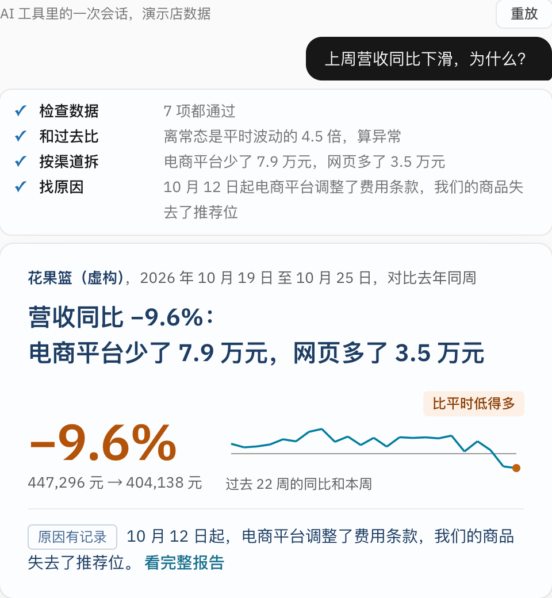
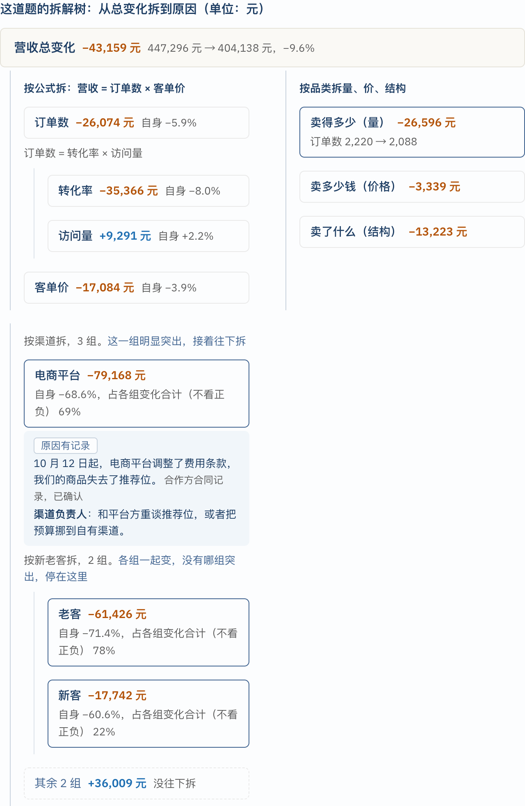
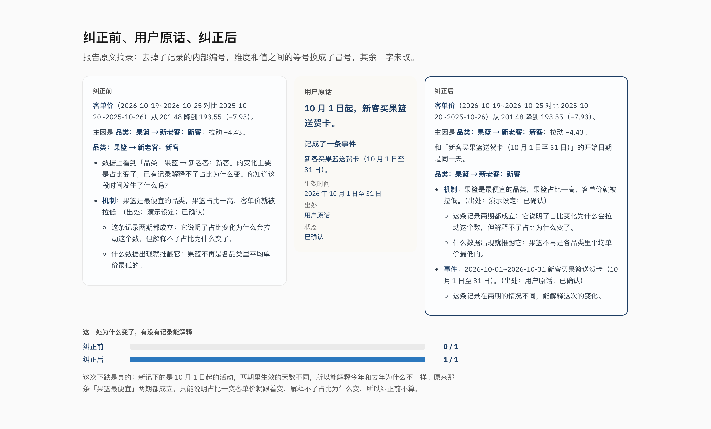
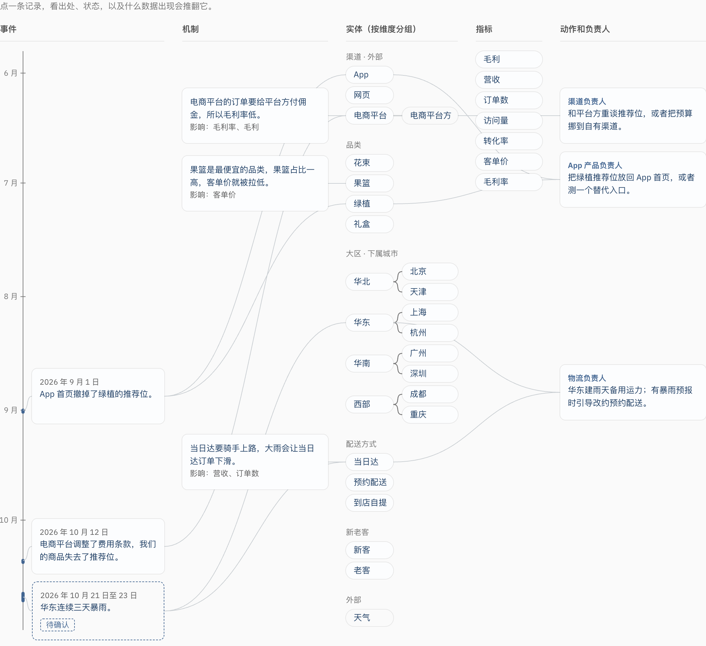

# analyst-in-a-box

[English](README.md)

[](LICENSE)
[](https://github.com/weigezi/analyst-in-a-box/actions/workflows/ci.yml)

## 把你手上的几张表，一键变成会答题的 AI 分析师。

问一句数字为什么变了，拿到原因、该谁行动，以及一份各项相加等于总变化的拆解。

<p align="center"></p>
<p align="center"><sub>演示店，数据由程序生成。<a href="docs/assets/demo.mp4">看 76 秒短片</a>。</sub></p>

**12 种公开发表的归因方法 &nbsp;·&nbsp; 报告交付前 12 项自检 &nbsp;·&nbsp; 没调过参的店里，埋下的原因 30 个全找回 &nbsp;·&nbsp; 178 个测试**

```bash
npx skills add weigezi/analyst-in-a-box
```

然后问你的 AI 工具：

> 这是我们的订单表（路径）。上周营收为什么跌了？

它会问每一列是什么，不按列名猜，然后在同一次对话里给出答案。

## 两种拆法，一个总数

营收少了 43,159。它拆两种，两种相加都等于这个数：按公式拆（转化率 −35,366，客单价 −17,084，访问量 +9,291），按渠道切（电商平台 −79,168，网页 +34,816，App +1,193）。只在某一组特别突出的地方继续往下切，几组一起动的地方就停。

<p align="center"></p>

所有计算都由脚本完成。用的是公开发表的方法（加法用 BEA 贡献度，乘法用 LMDI-I 和 Shapley，比率用 Kitagawa，一共 12 种），每种的出处写在 [`operators.zh.md`](skills/analyst-in-a-box/references/operators.zh.md)。交付前的 12 项自检有一项不过，报告就不发，并写明是哪一项。

## 原因是一条记录，不是换个说法的结果

「电商平台少了」说的是钱少在哪，没有说为什么。原因必须是一条带日期、带出处的记录，脚本再核对它能不能解释这一次的变化：

- 两期里不一样；
- 和变化从同一天开始；
- 去掉它之后，其余渠道看起来正常（涨 10.8%，平时约 7.7%）。

演示里的记录是：10 月 12 日起，电商平台调整了费用条款，我们的商品失去了推荐位（出处：合作方合同记录，已确认）。这份工作区是手写的，所以记录里还写了负责人（渠道负责人）和下一步。由几张表和一份周报自动形成的工作区，会得到同一个主因，标「待确认」，负责人留空，等你补。

## 数据有问题，它会说

少了两天，或订单导重了，报告会写明原因并停发，不给出原因的故事。平静的一周就报告为平静。这在 15 道陷阱题上测过：12 道没埋原因，误报 0；3 道埋了真原因，漏报 0。

纯噪声也不是零代价：300 周纯噪声里，营收有 15 周（5.0%）、客单价有 7 周（2.3%）仍被当成单点往下钻。

## 说一次，它就记住

说一句「10 月 1 日起，新客买果篮送贺卡」。它把你的话记成一条带日期的记录，出处写你的原话，下次遇到这道题就引用，同时写出一道回归检查。客单价变化能被解释的比例从 0 到了 100%。把这条记录删掉，检查就不通过（1/1 变成 0/1）。

<p align="center"></p>

它记下的东西按可信度分层。事实是你说的、业务系统里的记录、数据本身显示的。AI 推断是从文档里读出的、行业常识和猜测，在有人确认之前只是草稿。

## 订单、商品、流量、活动这些表，直接长成业务知识图谱

给它店里系统导出的订单表、商品表、城市对照表、流量表、活动日历、调价记录、节假日、天气和大盘指数，再加一份周报。脚本认出主表、查找表、表之间怎么连、哪些是事件表，每个判断都以选择题交回给你。演示里，9 张表（22.7 万笔订单）在店主答完选择题之后，脚本约 3 秒就变成能答题的工作区。它分两部分：**指标树**（什么往下拆成什么，每个指标按什么顺序切）和**业务世界描述**（实体、机制、带日期的事件、动作和负责人，每条带出处，以及什么数据出现就推翻它）。还在等你确认的条目画成虚线。

<p align="center"></p>

## 谁做什么

- **你**看它对你业务的理解对不对（它认出的表、列和连接，从文档里读出的原因），不对就纠正几处。
- **脚本**认出表、列和连接，算每一个数，跑每一道核对。
- **AI**听懂问题，把解释写成大白话，从你的文档里提出候选原因。

## 实测了什么

以下全部在生成的数据或一份公开数据集上测得，不是真实业务。

| 测了什么 | 结果 |
|---|---|
| 6 家生成的店（每家 5 道题），随机种子没调过参，埋下的原因找回 | 30 个，全部 |
| 陷阱题（12 道没埋原因，3 道埋了原因） | 误报 0，漏报 0 |
| 每种拆解都与总变化相加对得上 | 178 个测试全过，每份报告交付前也跑同样的核对 |
| 脚本每道题耗时，Apple Silicon 的 Mac | 中位数 0.31 秒（不含 AI 工具读写的时间） |

## 试试看

- 演示店上能问的：为什么营收跌了；为什么华东比其他地区跌得多；为什么客单价降了；6 月是卖得多了还是卖得贵了；App 为什么比网页长得慢。
- 订单、商品、流量这类多张表：放进同一个文件夹，有周报的话一起给。
- 在终端里用：`python3 skills/analyst-in-a-box/scripts/aib_cli.py init 你的数据.csv --workspace ./aib-workspace`
- 用真实运行结果构建演示站：`uv run python site/build.py`。跑测试：`uv run --frozen pytest`

## 文档

- [试用者说明](docs/trial.zh.md)：拿自己的生意试，以及要寄回什么。
- [决策记录](docs/decisions.zh.md)：为什么这样做。
- [几张表到一个工作区](demo/intake/README.zh.md)和[公开数据集](demo/public/README.zh.md)。
- [参与贡献](CONTRIBUTING.zh.md)和[安全](SECURITY.zh.md)。

## 现状

首个公开版本。已经测过：一家生成的演示店、另外六家生成的店、陷阱题，以及一份公开数据集（UCI Online Retail，CC BY 4.0）。这份数据集说明真实数据接得进、能出一份通过自检的报告；它没有答案，所以不能说明答案对不对。项目以外还没有人拿自己的生意试过，[试用者说明](docs/trial.zh.md)就是为了改变这一点。还没做：三阶问题，以及用户自己联网搜索以外的新闻来源。

发现问题，或在自己的数据上试过？请开一个 issue。许可证：[Apache-2.0](LICENSE)。`demo/public` 里的数据沿用它自己的授权。
